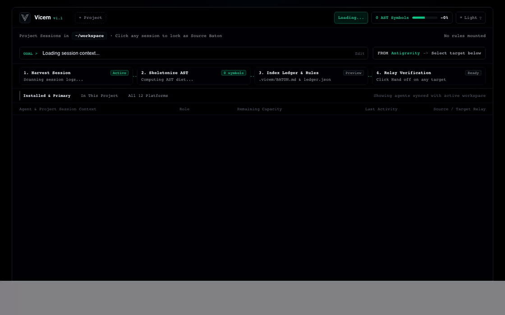

<p align="left">
  <picture>
    <source media="(prefers-color-scheme: dark)" srcset="./logo-dark-transparent.png" />
    <source media="(prefers-color-scheme: light)" srcset="./logo-light-transparent.png" />
    
  </picture>
</p>

# Vicem — Diet the Context, Pass the Baton

> **Hit Claude's 5-hour quota limit mid-refactor? Or watching your AI agent lose its mind after 150k tokens of context rot?**
>
> **Hand off your exact coding session, git diff, and compressed code skeletons to Codex, Gemini, Cursor, Antigravity IDE, or Web AI in 3 seconds — with up to 90% fewer tokens and `0` third-party dependencies.**

<p align="left">
  <a href="https://rakkunn.github.io/vicem/"><strong>Launch Zero-Install Browser Studio (GitHub Pages)</strong></a> ·
  <a href="https://github.com/Rakkunn/vicem"><strong>GitHub Repository</strong></a> ·
  <a href="./SECURITY.md"><strong>Security &amp; Minimal TCB</strong></a>
</p>

<p align="center">
  <picture>
    <source media="(prefers-color-scheme: dark)" srcset="./gui-dark.png" />
    <source media="(prefers-color-scheme: light)" srcset="./gui-light.png" />
    
  </picture>
</p>



```text
$ vicem codex

  ╭─ VICEM CONTEXT BATON & DIET RECEIPT ──────────────────────────────────╮
  │ Source Session : Claude Code (sess-9f3a2c · 42 turns harvested)       │
  │ Context Diet   : 184,200 tok ($2.76) ──► 14,800 tok ($0.22) [-91.9%]  │
  │ Code Skeletons : 18 files compressed (31 bodies indexed in ledger)    │
  │ Security Guard : 2 secrets redacted (OPENAI_KEY, AWS_ACCESS_KEY)      │
  │ Relay Target   : OpenAI Codex CLI (interactive TTY handoff ready)     │
  ╰───────────────────────────────────────────────────────────────────────╯
[OK] [Vicem] Baton written to .vicem/BATON.md (182ms). Launching codex...
```

---

## Measured Pipeline Contribution (Before vs. After Vicem)

| Pipeline Stage | Raw Session State (Before Vicem) | After Vicem Baton & Diet | Measured Contribution |
| :--- | :--- | :--- | :--- |
| **1. Session Continuity Relay** | 40+ turns of raw JSONL / SQLite history locked inside a single agent | Harvests active `Goal`, `Done`, `Immediate NEXT` & `git diff` into `.vicem/BATON.md` | **< 3s handoff** across 15+ CLI, IDE & Web AI agents |
| **2. Code Skeletonization** | Full source files with long implementation bodies (`~120,000 tok`) | Types & signatures 100% intact; bodies `>= 12` lines indexed in `.vicem/ledger.json` | **-80% to -90% code tokens** (100% lossless via MCP `vicem_rehydrate`) |
| **3. Test & Error Log Slimming** | Verbose ANSI spinners & `node_modules` stack frames (`~45,000 tok`) | Root failure message + top 5 project stack frames (`~1,200 tok`) | **-95% log noise** while preserving exact failure root cause |
| **4. Data Sampling & Noise Gate** | Lockfiles, build bundles, and multi-megabyte JSON / CSV / SQL dumps | Artifacts filtered; data files reduced to inferred schema + 2 sample rows | **-98% data bloat** & zero context window overflow |
| **5. Security & Write Integrity** | Plaintext credentials in logs & risk of placeholder overwrites | 3-Tier local secret redaction + `SkeletonWriteGuard` & `SecretCommitGuard` | **0 leaked secrets** & **0 external packages (`dependencies: 0`)** |

---

## 1-Click Setup (macOS, Windows, Linux — Zero Terminal Config Needed)

### Option A: Double-Click Installer (Recommended)
```bash
git clone https://github.com/Rakkunn/vicem.git && cd vicem
```
1. **macOS / Linux:** Double-click **`setup.command`** (or run `./vicem.mjs setup`).
2. **Windows:** Double-click **`setup.bat`**.
3. **Browser-Only (Air-Gapped / No Node.js):** Open **[https://rakkunn.github.io/vicem/](https://rakkunn.github.io/vicem/)** or double-click **`index.html`** locally in Chrome, Edge, Brave, or Safari (`connect-src 'none'`).

Wait 2 seconds — Vicem automatically registers the global `vicem` command, configures MCP servers across your installed agents (Claude Code, Codex, Cursor, Windsurf, Antigravity IDE), and installs the `.agents/skills/vicem/SKILL.md` skill.

### Option B: Interactive Desktop Utility GUI & Direct CLI Usage
Vicem consists of **standalone files** (`vicem.mjs`, `vicem-gui.mjs`, `index.html`, `.agents/skills/vicem/SKILL.md`) built entirely on Node.js standard library modules:

```bash
# 1. Launch the interactive Desktop Utility GUI (12 platforms, live quota telemetry, 1-click handoff)
vicem gui

# 2. One-click auto-setup (PATH + MCP registration + Git pre-commit guard)
./vicem.mjs setup

# 3. Auto-detect active session and pass baton to recommended target
vicem

# 4. Pass baton to a specific CLI, IDE, or Web AI target (12 platforms across macOS / Windows / Linux)
vicem codex
vicem claude
vicem gemini
vicem cursor
vicem windsurf
vicem vscode
vicem cline
vicem opencode
vicem aider
vicem goose
vicem ide
vicem web

# 5. Compact current bloated session in-place (Context Rot Rescue)
vicem self

# 6. Return baton to previous agent & auto-unmount temporary rules
vicem back

# 7. Restore pre-handoff file snapshot or roll back session
vicem rollback

# 8. Open Hydrated Zero-Network Web Studio (.vicem/studio.live.html)
vicem studio

# 9. Extract & smart-patch code blocks from Web AI clipboard reply
vicem land

# 10. Run <50ms zero-spawn environment & agent storage diagnostics
vicem doctor
```

---

## Architecture & Core Capabilities

1. **Zero-Config 1-Command Relay (`vicem codex`, `vicem claude`, `vicem ide`, `vicem web`):**
   - Auto-detects the active source session strictly scoped to the current project directory (`cwd`), preventing cross-project session bleed.
   - Length-adaptive fuzzy target matching (`vicem codexx` → `codex`, `vicem claud` → `claude`).
   - Interactive CLI handoff preserves full TTY keyboard control (`stdio: 'inherit'`).
2. **4-Stage Context Diet Engine (`-75%` to `-90%` Token Reduction):**
   - **Stage 1 (Noise Gate):** Drops lockfiles, build artifacts, binaries, and minified bundles.
   - **Stage 2 (Code Skeletonizer):** Preserves `interface`, `type`, `enum`, and class/method signatures 100% intact while replacing function bodies `>= 12` lines with `/* ... */` or `pass` (indexing full bodies in `.vicem/ledger.json` for on-demand MCP rehydration).
   - **Stage 3 (Log Slimmer):** Strips ANSI codes, carriage-return spinners, and `node_modules`/`site-packages` frames while preserving the root error and 5 user stack frames.
   - **Stage 4 (Data Sampler):** Compresses large JSON/CSV/SQL files into compact schemas + 2 sample rows.
3. **Bookended U-Shaped Attention Baton IA (`.vicem/BATON.md`):**
   - **Zone 1 (Top Primacy 15%):** `# BATON` header, `## 1. Goal`, and `## 2. Immediate NEXT`.
   - **Zone 2 (Middle Evidence 75%):** `## 3. Done`, `## 4. Work Evidence (Git Diff & Slimmed Logs)`, `## 5. Architectural Context (Code Skeletons)`, and `## 6. Diet Ledger`.
   - **Zone 3 (Bottom Recency 10%):** `EXECUTION ANCHOR` preventing placeholder writes and anchoring immediate execution.
4. **3-Tier Secret Redactor & 3-Pillar Safety Guards:**
   - Redacts AWS, GitHub, OpenAI, Anthropic, Google, Slack, Stripe, JWT, PEM private keys, and high-entropy assignments into `‹REDACTED:PROVIDER:HASH4›`.
   - **Pre-Handoff Lossless Snapshot (`.vicem/snapshots/<batonId>/`):** Protects dirty working-tree files without ever running destructive `git checkout --`.
   - **`SkeletonWriteGuard` & `SecretCommitGuard`:** Blocks agents from writing `{ ... }`, `/* ... */`, `‹REDACTED:...›`, or `<!-- VICEM-BATON-START -->` markers into source files.

---

## Manual MCP Server Registration (Optional)

If you prefer manual registration over `./vicem.mjs setup`, register `vicem.mjs mcp` so agents can call `vicem_create_baton`, `vicem_read_baton`, `vicem_rehydrate`, and `vicem_check_guard`:

```bash
# Claude Code
claude mcp add vicem -- node /absolute/path/to/vicem.mjs mcp

# OpenAI Codex CLI
codex mcp add vicem -- node /absolute/path/to/vicem.mjs mcp
```

---

## Supply-Chain Verification & Minimal TCB

Verify zero third-party dependencies and cryptographic artifact integrity in one command:

```bash
# 1. Confirm zero npm dependencies
node -e "console.log(JSON.parse(fs.readFileSync('package.json')).dependencies ?? '0 dependencies')"

# 2. Verify SHA-256 checksums of all core artifacts
shasum -a 256 -c SHA256SUMS

# 3. Run under strict Node.js Permission Model sandbox
node --permission \
  --allow-fs-read=. \
  --allow-fs-write=.vicem \
  --allow-child-process \
  vicem.mjs diet
```

---

## Automated Test Suite

```bash
node --test test/*.test.mjs
```
