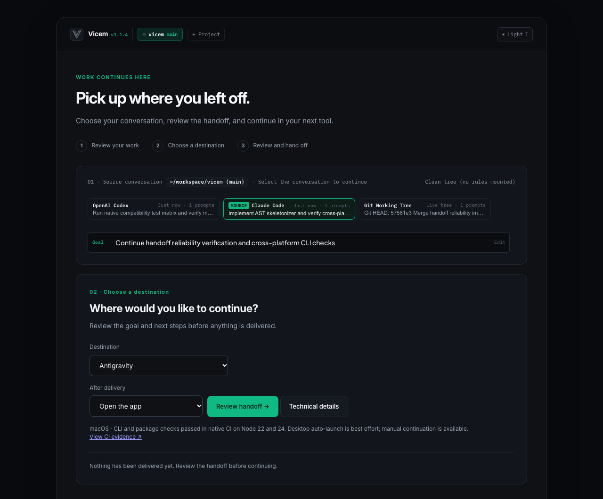

<p align="left">
  <picture>
    <source media="(prefers-color-scheme: dark)" srcset="./logo-dark-transparent.png" />
    <source media="(prefers-color-scheme: light)" srcset="./logo-light-transparent.png" />
    
  </picture>
</p>

# Vicem — Diet the Context, Pass the Baton

<p align="left">
  <a href="https://glama.ai/mcp/servers/RAKKUNN/vicem"></a>
  <a href="https://mcpservers.org/servers/rakkunn/vicem"></a>
  <a href="https://www.npmjs.com/package/vicem-cli"></a>
  <a href="https://github.com/RAKKUNN/vicem/releases/tag/v1.1.5"></a>
  
  <a href="./LICENSE"></a>
</p>

> **Hit Claude Code's 5-hour quota mid-feature? Or watching Cursor / Codex slow to a crawl after 150k tokens of context rot?**
>
> **Vicem** compacts your active coding session by **80–99%** (via deterministic AST code skeletonization + lossless MCP on-demand rehydration) and hands off a clean `.vicem/BATON.md` across **Claude Code, Cursor, Codex CLI, Gemini CLI, Windsurf, Antigravity IDE, and Web AI** in 3 seconds — with **`0` npm dependencies** and **`0` network calls**.
>
> ⭐ **Tip:** Click **Star** (top-right) to bookmark this repo for the next time your coding agent hits a 5-hour quota limit or context rot.

---

## ⚡ 10-Second Quick Start (`npx` — Zero Install)

### 1. Run the Local Handoff GUI or Pass a Baton Immediately
```bash
# Launch the local Handoff GUI (3-step guided handoff, preview confirmation & manual recovery)
npx -y vicem-cli gui

# Or pack a compressed baton from your current repo & hand off in 1 command
npx -y vicem-cli codex
npx -y vicem-cli claude
npx -y vicem-cli cursor

# Or auto-configure global `vicem` CLI + MCP servers across all installed agents
npx -y vicem-cli setup
```

### 2. Add as an MCP Server in 1 Line (Claude Code / Codex / Cursor)
```bash
# Claude Code
claude mcp add vicem -- npx -y vicem-cli mcp

# OpenAI Codex CLI
codex mcp add vicem -- npx -y vicem-cli mcp
```

<details>
<summary><strong>Cursor / Windsurf / Claude Desktop (<code>mcp.json</code> config)</strong></summary>

Add to `~/.cursor/mcp.json`, `~/.codeium/windsurf/mcp_config.json`, or `claude_desktop_config.json`:

```json
{
  "mcpServers": {
    "vicem": {
      "command": "npx",
      "args": ["-y", "vicem-cli", "mcp"]
    }
  }
}
```
</details>

<p align="left">
  <a href="https://rakkunn.github.io/vicem/"><strong>🌐 Try Zero-Install Browser Sandbox (GitHub Pages)</strong></a> ·
  <a href="https://www.npmjs.com/package/vicem-cli"><strong>📦 npm (vicem-cli / @rakkunn/vicem)</strong></a> ·
  <a href="./SECURITY.md"><strong>🔒 Security &amp; Zero-Network Proof</strong></a>
</p>

---

## Visual Overview

<p align="center">
  <picture>
    <source media="(prefers-color-scheme: dark)" srcset="./gui-dark.png" />
    <source media="(prefers-color-scheme: light)" srcset="./gui-light.png" />
    
  </picture>
</p>

1. **Review your work (`01 · Source conversation`)**: Select the active project and source conversation, and inspect or edit the extracted handoff goal.
2. **Choose a destination (`02 · Choose a destination`)**: Pick the target agent (`Claude Code`, `OpenAI Codex`, `Cursor`, `Antigravity`, `Gemini CLI`, `Windsurf`, `VS Code`, `Web Chat`) and delivery action (`Open the app`, `Open in terminal`, or `Prepare handoff only`).
3. **Review and hand off (`03 · Review handoff`)**: Inspect the exact `.vicem/BATON.md` summary before anything is written or launched. If automatic launch is unavailable, copy the saved `BATON.md` path, shell continuation command, and start prompt directly from the recovery panel.

```text
$ npx -y vicem-cli codex

  ╭─ VICEM CONTEXT BATON & DIET RECEIPT ──────────────────────────────────╮
  │ Source Session : Claude Code (sess-9f3a2c · 42 turns harvested)       │
  │ Context Diet   : 184,200 tok ($2.76) ──► 14,800 tok ($0.22) [-91.9%]  │
  │ Code Skeletons : 18 files compressed (31 bodies indexed in ledger)    │
  │ Security Guard : 2 secrets redacted (OPENAI_KEY, AWS_ACCESS_KEY)      │
  │ Relay Target   : OpenAI Codex CLI (interactive TTY handoff ready)     │
  ╰───────────────────────────────────────────────────────────────────────╯
[OK] [Vicem] Baton written to .vicem/BATON.md (182ms). Launching codex...
```

---

## How Lossless Code Skeletonization + MCP Rehydration Works

Instead of lossy LLM summarization that forgets exact type contracts, Vicem keeps all imports, types, and signatures 100% intact inside `.vicem/BATON.md` while collapsing unchanged function bodies `>= 12` lines into `.vicem/ledger.json`:

```ts
// What the receiving agent sees in .vicem/BATON.md (-85% tokens, disk file untouched):
export interface JwtPayload { sub: string; exp: number; role: 'admin' | 'user'; }
export async function verifySessionToken(rawToken: string, secret: string): Promise<JwtPayload> { /* ... */ }
```

When the receiving agent actually needs to edit `verifySessionToken`, it calls the MCP tool **`vicem_rehydrate("src/auth.ts", "verifySessionToken")`** to pull back the exact raw lines on demand (with automatic git HEAD and live-file SHA-256 staleness detection).

| Pipeline Stage | Before Vicem (Raw Session) | After Vicem Baton & Diet | Token Savings |
| :--- | :--- | :--- | :--- |
| **1. Session Handoff** | 40+ turns of raw JSONL / SQLite history locked in one tool | Extracts `Goal`, `Done`, `Immediate NEXT` & `git diff` into `.vicem/BATON.md` | **< 3s handoff** across 12+ CLI, IDE & Web AI agents |
| **2. Code Skeletonizer** | Full source files with unchanged function bodies (`~120,000 tok`) | Signatures & types 100% intact; bodies indexed in `.vicem/ledger.json` | **-80% to -90% code tokens** (lossless via `vicem_rehydrate`) |
| **3. Test & Log Slimmer** | Verbose ANSI spinners & `node_modules` stack frames (`~45,000 tok`) | Failing assertion + top 5 user-code stack frames (`~1,200 tok`) | **-95% log noise** |
| **4. Data & Noise Gate** | Lockfiles, build bundles, and huge JSON / CSV / SQL dumps | Lockfiles dropped; data files reduced to inferred schema + 2 sample rows | **-98% data bloat** |
| **5. Safety & Secret Guard** | Plaintext `.env` keys in logs & risk of placeholder overwrites | Local secret redaction + `SkeletonWriteGuard` pre-commit protection | **0 leaked secrets** & **0 npm dependencies** |

---

## Direct CLI Commands & Offline Source Setup

```bash
# 1. Launch the interactive Desktop Utility GUI
vicem gui

# 2. Compact current bloated session in-place (Context Rot Rescue)
vicem self

# 3. Pass baton to any CLI, IDE, or Web AI target
vicem codex | vicem claude | vicem gemini | vicem cursor | vicem windsurf | vicem vscode | vicem web

# 4. Return baton to previous agent & auto-unmount temporary rules
vicem back

# 5. Extract & smart-patch code blocks from a Web AI clipboard reply
vicem land

# 6. Run <50ms environment & agent storage diagnostics
vicem doctor
```

<details>
<summary><strong>Offline / Air-Gapped Source Clone Installer (No npm required)</strong></summary>

```bash
git clone https://github.com/RAKKUNN/vicem.git && cd vicem
./vicem.mjs setup   # or double-click setup.command (macOS/Linux) / setup.bat (Windows)
```
For browser-only air-gapped environments without Node.js, open **`index.html`** directly in Chrome, Edge, Brave, or Safari (enforced by `connect-src 'none'` CSP).
</details>

---

## Supply-Chain Verification & Minimal TCB

Verify zero third-party dependencies and cryptographic artifact integrity in one command:

```bash
# 1. Confirm zero npm dependencies
node -e "console.log(JSON.parse(fs.readFileSync('package.json')).dependencies ?? '0 dependencies')"

# 2. Verify SHA-256 checksums of all core artifacts
shasum -a 256 -c SHA256SUMS

# 3. Run the 769-test automated suite
node --test test/*.test.mjs
```


## Reviewed handoffs and safe recovery

Start the local interface with `node vicem.mjs gui`. Select the project and source conversation, edit the goal, choose the destination and launch mode, then review before delivery. Technical telemetry is available under details.

- `node vicem.mjs codex --preview`: preview without saving handoff artifacts or launching an app.
- `node vicem.mjs codex --preview --json`: structured preview for automation.
- `node vicem.mjs status --json` / `node vicem.mjs history --json`: inspect recorded outcomes.
- `node vicem.mjs undo <handoff-id>`: restore instruction changes for that handoff only. If those instructions have since changed, recovery refuses to overwrite them. This does not undo agent edits to source code.

The GUI rejects a reviewed handoff if its content changes before delivery. Delivery and application launch do not establish that an agent has read the context: reception remains unconfirmed. The preview token is a consistency check, not authentication. Legacy `--dry-run` still writes handoff artifacts; use `--preview` for a read-only preview.

Validation: automated unit/integration tests and local macOS browser checks. Windows/Linux real-agent launch and actual target-agent reception are not certified by these tests. GUI and CLI share preparation, rule mounting, outcome history and instruction recovery; platform launch adapters remain distinct.


See [compatibility verification](docs/COMPATIBILITY.md) for tested operating systems, actual agent read proofs, and limitations.


### Automatic launch and manual continuation

Windows CLI/package behavior is verified in native CI on Node 22 and 24. Windows desktop integration remains Preview; desktop auto-launch on every OS is best effort. [View the passing CI run](https://github.com/RAKKUNN/vicem/actions/runs/41040234570) and [the precise support scope](docs/COMPATIBILITY.md).

If automatic launch fails, the handoff stays saved. The GUI provides **Copy command**, **Copy start prompt**, and the saved file path. Open the destination manually, select your project, and paste the start prompt. CLI failures provide the same guide. Successful delivery does not confirm that an agent read it.
